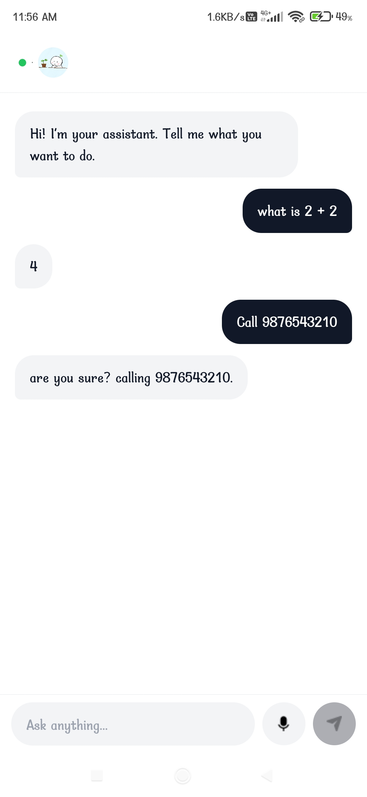

# Android Assistant
A lightweight, on-device Android assistant that understands voice or text commands and performs supported phone actions.

## 🔴 Demo

### 🔴 🖼️ Screenshot

### 🔴 📱 Android App

⬇️ Download APK  
https://github.com/PriDebnath/pri-assistant/releases/latest/download/app-release.apk

 
---

## How It Works
1. Normalize the user's request.
2. Match it with the rule-based intent parser.
3. If no intent matches, use the AI intent parser as a fallback.
4. Execute the action and return a short response.
5. Ask for confirmation when a phone call needs approval.

---

## Supported Features

### Apps
Open supported apps:
- Chrome / Browser / Google
- WhatsApp
- Spotify
- Google Maps
- Settings

### Web & Media
- Search the web.
- Play a YouTube video.
- Play music on YouTube Music.

### Phone Controls
- Increase, decrease, mute, or unmute media volume.
- Set or check screen brightness.
- Turn the flashlight on or off.

### Contacts & Calls
- Find a contact by name or search for a phone number.
- Select a contact from matching results.
- Call a phone number or contact.
- Confirm or reject a pending call.

### Calculator
- Perform basic arithmetic: addition, subtraction, multiplication, division, and modulo.

---

## Example Commands

| Task           | Example                               |
|----------------|---------------------------------------|
| Open an app    | “Open WhatsApp”                       |
| Search the web | “Search for React Native tutorials”   |
| Play a video   | “Play a video about space on YouTube” |
| Play music     | “Play some relaxing music”            |
| Control volume | “Turn up the volume”                  |
| Set brightness | “Set brightness to 60 percent”        |
| Flashlight     | “Turn on the flashlight”              |
| Find a contact | “Find Rahul’s number”                 |
| Make a call    | “Call 9876543210”                     |
| Calculate      | “Multiply 25 by 18”                   |

